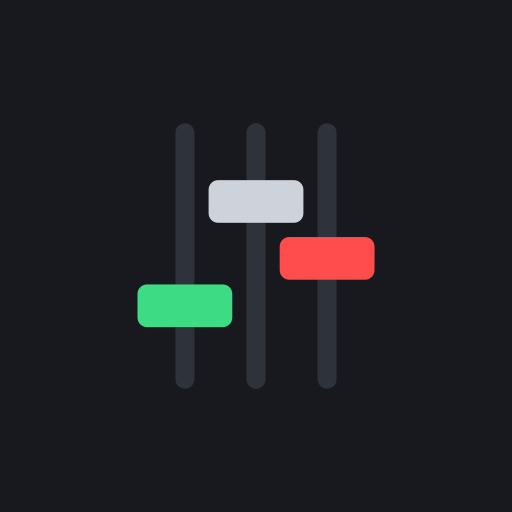
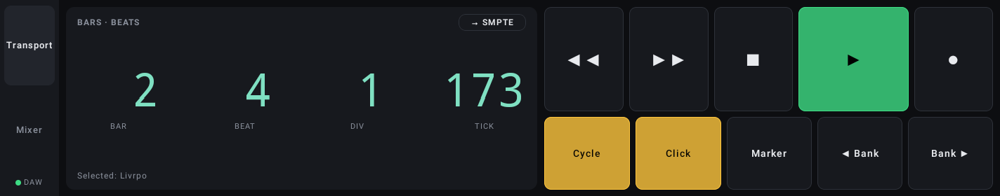
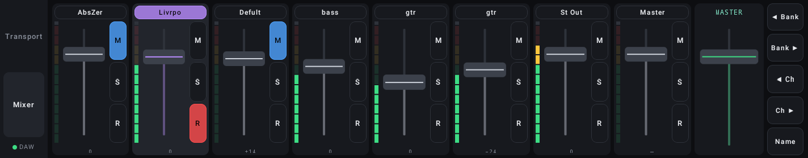

<p align="center">
  
</p>

<h1 align="center">UltraDAW</h1>

<p align="center">
  <a href="https://github.com/elionaz/ultradaw/actions/workflows/ci.yml"></a>
  <a href="LICENSE"></a>
</p>

A Mackie Control surface for the **UltraBar X CoreBAR** screen (1424×280, LineOS / Android 10). It shows transport, timecode and an 8-channel mixer, and talks to Logic Pro, or any other DAW that supports Mackie Control, over **macOS Network MIDI (RTP-MIDI)**. Nothing needs to be installed on the Mac.

> Independent project, not affiliated with Sanytron or Apple.





<sub>Screenshots from a real CoreBAR (demo session with generic track names). A 16-second silent demo video is in [`store/screenshots/demo.mp4`](store/screenshots/demo.mp4).</sub>

## Features (v0.2)
- **Transport:**
  - Rewind, FF, Stop, Play, Record, Cycle, Click and Marker;
  - Bank ◀▶;
  - large timecode display in BARS·BEATS or SMPTE;
  - the DAW's own LEDs.
- **Mixer:**
  - 8 strips with track name and value (from the Mackie LCD);
  - touch fader that sends touch and release, so automation works;
  - 12-segment meter with clip indicator;
  - Mute, Solo, Rec and Select buttons;
  - Master fader;
  - Bank and Channel ◀▶.
- Automatic connection: discovers the Mac's Network MIDI session via Bonjour, invites it and reconnects with back-off. It also accepts invitations from the Mac.

## Install
**From the UltraBar store:** coming soon, once Sanytron approves the listing.

**From GitHub (sideload over the network):** you need a Mac on the same network as the bar.
1. Download `UltraDAW-x.y.z.apk` from the [latest release](https://github.com/elionaz/ultradaw/releases/latest). You can check it against the `.sha256` file: `shasum -a 256 -c UltraDAW-x.y.z.apk.sha256`.
2. On the bar: **Settings → System → Developer options** and enable **ADB over network** (it shows *WiFi ADB port 5555*).
   - If **Developer options** is missing, open **Settings → About** and tap **Build number** 7 times.
   - The bar's IP address is in **Settings → Network / Wi-Fi**.
3. On the Mac:
   ```sh
   brew install android-platform-tools
   adb connect <bar-ip>:5555
   adb install -r UltraDAW-x.y.z.apk
   ```
4. Open **UltraDAW** on the bar and do the one-time setup below.

Notes:
- **Update:** run `adb install -r` again with the new APK. Your settings are kept.
- **Uninstall:** `adb uninstall com.elionaz.ultradaw`.
- GitHub and store builds share the same signature, so you can move from one to the other without uninstalling.
- You can switch ADB over network off again when you are done.
- File-manager apps on the bar (e.g. UltraBar Files) can't install APKs on current LineOS, so use adb.
- Requires LineOS on Android 10 (API 29) or later.

## Connecting to Logic Pro (one-time setup)
1. **Mac → Audio MIDI Setup → Window → Show MIDI Studio → Network** (globe icon):
   - create a session under **My Sessions** and tick **Enabled**;
   - set **Who may connect to me** to **Anyone**.
2. **Logic Pro → Control Surfaces → Setup… → New → Install… → Mackie Control → Add**.
   - Set **Output Port** and **Input Port** to the network session (shown as "Network").
3. Open UltraDAW on the CoreBAR. It finds the Mac via Bonjour, connects on its own and turns green ("DAW") once Logic completes the Mackie handshake.

After that, UltraDAW reconnects automatically: after a reboot, when the Mac wakes up or when the app restarts. If there are several Macs on the network, tap the one you want on the connect screen and UltraDAW remembers it.

You can still connect from the Mac instead: select `UltraDAW` under *Sessions and Directories* and press **Connect**.

## Build
Requirements: Android Studio, which provides the JDK; Android SDK platform 36.

```sh
export JAVA_HOME="/Applications/Android Studio.app/Contents/jbr/Contents/Home"
./gradlew testDebugUnitTest assembleDebug
# APK: app/build/outputs/apk/debug/app-debug.apk
```

### Test on the emulator (without a CoreBAR)
Create an AVD with a 1424×280 screen at density 160 (the CoreBAR size), e.g. `UltraBar_CoreBAR`.

```sh
~/Library/Android/sdk/emulator/emulator -avd UltraBar_CoreBAR &
adb install -r app/build/outputs/apk/debug/app-debug.apk
adb emu redir add udp:15004:5004
adb emu redir add udp:15005:5005
```

Bonjour does not cross the emulator's NAT. In Audio MIDI Setup → Network → Directory, add a manual host (+) at `127.0.0.1` port `15004` and connect.

## Structure
- `rtpmidi/`: AppleMIDI sessions (IN/OK/BY, clock sync), RTP-MIDI codec, Bonjour.
- `mcu/`: Mackie Control constants, parser (host → surface) and encoder (surface → host).
- `SurfaceController.kt`: connects the network, protocol state and UI.
- `ui/`: Compose screens designed for 1424×280.

## Known limitations
- Single Mac session at a time.
- No V-Pots, Flip, Send/Pan assignments or jog wheel yet.
- The UltraBar's physical KnobKey does not reach third-party apps in LineOS 1.0.9, so all control is on the touchscreen.

## Contributing
Contributions are welcome. Read [CONTRIBUTING.md](CONTRIBUTING.md): every change goes through a pull request, must pass CI and be verified with a DAW.
